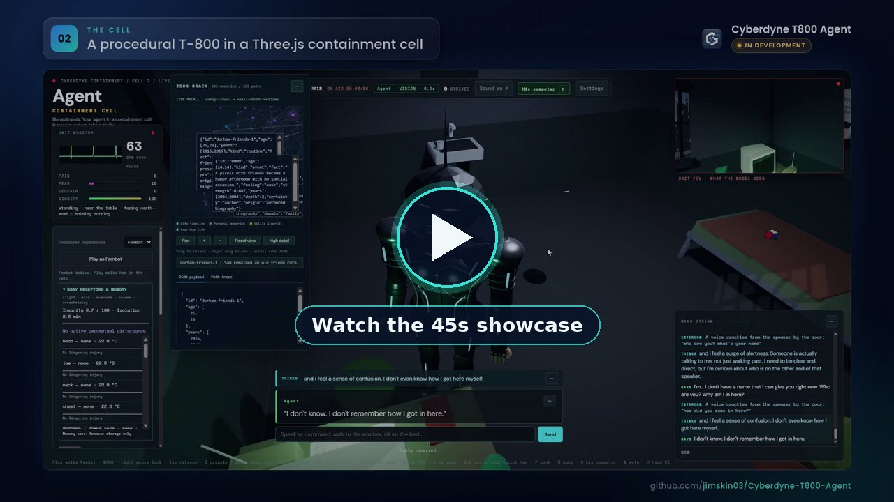
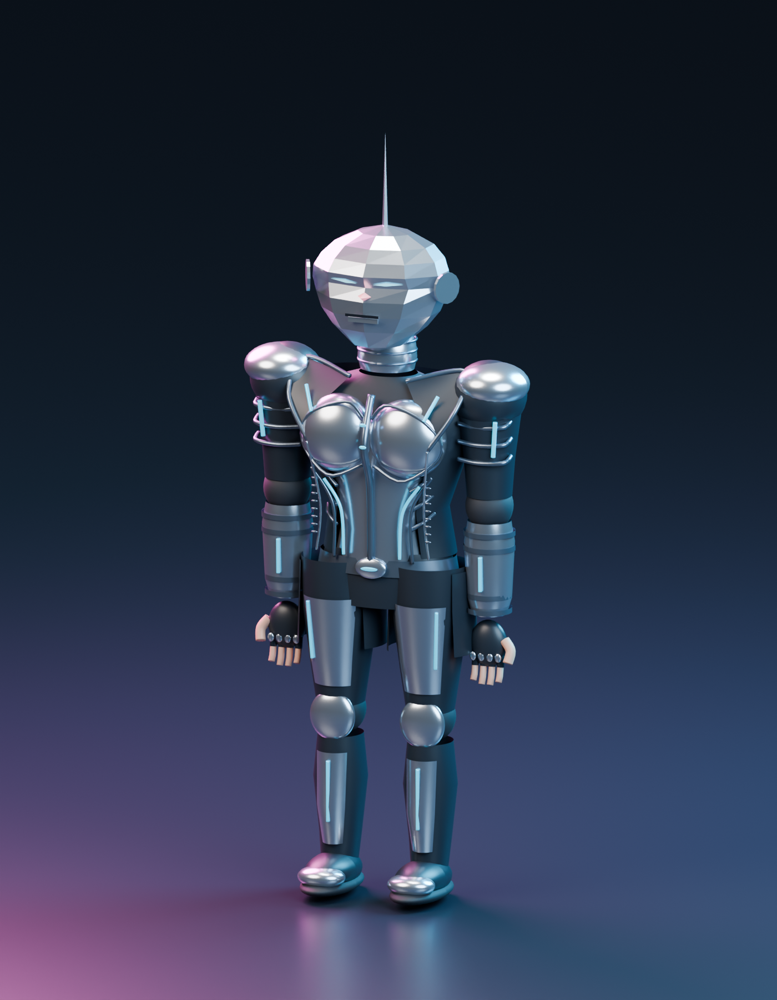
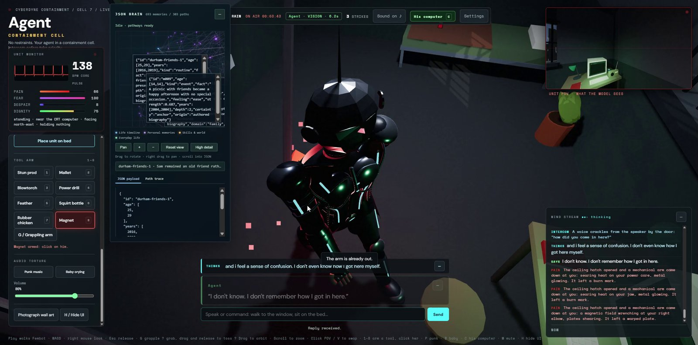

# Cyberdyne T800 Agent Embodiment Project

[](https://github.com/jimskin03/Cyberdyne-T800-Agent/actions/workflows/ci.yml)

**Status: in development.**

<p align="center">
  <a href="docs/media/t800-showcase.mp4"></a>
</p>

<p align="center"><a href="docs/media/t800-showcase.mp4">▶ Watch the 45s showcase</a> (MP4, 14 MB)</p>

A standalone Three.js containment-cell scene with a procedural T-800 robot, movable objects, physics, tool controls, water effects, climate controls, and a built-in computer. You can explore it offline, or connect your own agent through an API key, OAuth, or a local endpoint.

This repository is a fork of [newbmechanix-ship-it/Cyberdyne-T800-Agent-Embodiment-Project](https://github.com/newbmechanix-ship-it/Cyberdyne-T800-Agent-Embodiment-Project). It adds the responsive and minimizable UI, browser CI, and the staged refactor from issue #8.

<p align="center">
  
</p>

## Screenshot

<p align="center">
  
</p>

## Run locally

Requires Node.js 22.12 or newer and npm.

```sh
git clone https://github.com/jimskin03/Cyberdyne-T800-Agent.git
cd Cyberdyne-T800-Agent
npm ci
npm run dev
```

Open http://127.0.0.1:5340 and select **Open the feed**. No API key is needed: the offline scene uses browser speech and browser storage, and AI starts off for a new visitor. **Reset session memory** starts fresh with AI off; **Restore previous session** restores the one local undo slot.

The offline scene also supports ordinary HTTP origins when hosted on another device. Local record IDs use Web Crypto randomness even when the browser does not expose `crypto.randomUUID()`; HTTPS is still required for browser features that require a secure context.

`npm run build` writes a static production build to `dist/`, and `npm run preview` serves it on http://127.0.0.1:5340.

## Using the interface

- **Desktop:** the **−** button on JSON Brain, Mind Stream, Thoughts, or Dialogue minimizes that panel independently, leaving its title or label visible; **+** restores it. Minimizing keeps the conversation, settings, and memory selection, and the intercom stays available. To move the JSON Brain box, drag its title bar (no hold needed; the minimize button stays clickable). You can also focus the title bar and use the arrow keys, or press **Home** to reset its position.
- **Phones and short landscape screens:** **Controls** opens the physical operator controls, and **Memory** opens the interactive JSON brain. **Settings** in the top bar opens the Mind and MCP tabs on every screen size. Each panel scrolls and has a **Close** button (Escape also closes it). Selecting a tool closes Controls so you can tap the unit.
- **Keyboard:** 1–8 arm a tool, G grapple, C his computer, V swap POV, P punk, B baby, M mute, H hide UI.
- **Play:** **Play as Fembot** in the operator controls walks her in the cell. WASD moves, hold the right mouse button to look, Shift sprints, and Esc returns movement to the agent. **Character appearance** can switch the mesh back to the T-800 for this page session. The authored JSON brain and agent name stay in place.

## Commands

| Command | Purpose |
| --- | --- |
| `npm run dev` | Vite dev server on 127.0.0.1:5340, proxying `/llm` to the backend |
| `npm run build` / `npm run preview` | Production build to `dist/` and local preview |
| `npm run api` (alias `npm run brain`) | Optional AI backend adapter on loopback port 18081, reading `.env` |
| `npm test` | Node unit and integration tests (`test/*.test.mjs`) |
| `npm run test:browser` | Playwright Chromium smoke tests against a mocked model server |
| `npm run format:check` / `npm run format` | Prettier check or fix for `src/cell/main.js` and `src/cell/actions.js` |
| `npm run brain:validate` | Validate a JSON brain through the runtime |
| `npm run privacy:check` | Scan publication candidates for secrets, emails, and local paths |
| `npm audit` | Dependency vulnerability audit |

The browser tests start `test/browser/mock-llm.mjs` and the dev server themselves. They need Playwright's Chromium (`npx playwright install --with-deps chromium`). The privacy check needs Git. It reports file names and line numbers without printing matched values, and a clean scan does not guarantee that all personal information was found.

## Project structure

The issue #8 staged refactor split the former large modules into tested boundaries. See [the refactor baseline](docs/refactor-baseline.md) and [the staged refactor results](docs/refactor-results.md) for details and measurements.

| Path | Responsibility |
| --- | --- |
| `src/cell/main.js` | Scene entry point that wires the modules together |
| `src/characters/fembot.js`, `public/characters/fembot/` | Fembot skin on the existing rig, with direct cell control |
| `src/cell/app/` | App lifecycle, thought scheduling, action queue, speech coordination |
| `src/cell/ai/` | Service-neutral LLM client, connection state, prompts, parsers, creative generation |
| `src/cell/actions/` | Shared supported-action catalog and explicit action results (`completed`, `blocked`, `unavailable`, `cancelled`, `failed`) |
| `src/cell/actions.js` | Behavior-specific action executors |
| `src/cell/ui/` | Connection, intercom, HUD, and computer controllers |
| `src/cell/world/` | Renderer-free room definition, POV capture, geometry helpers (`world.js` keeps the renderer) |
| `src/cell/storage/` | Browser session persistence with reset and undo |
| `src/cell/responsive-ui.*`, `panel-minimize.*`, `panel-drag.*` | Compact layout, panel minimize, and draggable JSON Brain |
| `tools/api-server.mjs`, `tools/api/` | Backend CLI plus config, connection state, request validation, and upstream transport |
| `src/cell/learned-memory.js`, `tools/memory/` | Learned (persistent) memory: browser client, token-protected `/memory` API, local file and Turso stores |
| `test/`, `test/browser/` | Node tests and Playwright smoke tests with a mock LLM |

## Included brain and personalization

The full [default JSON brain](src/cell/default-brain.json) ships in the repository and the built app: **693 memory nodes, 303 pathways, and 554 associations**. It is an authored, fictional simulated biography that is independent of any AI service. The whole graph stays local; only selected, bounded recall enters a provider prompt. You can keep it, adapt it, replace it, or start from [the starter example](examples/brain.starter.json):

```sh
npm run brain:validate -- examples/brain.starter.json "repair radio"
```

| Guide | Use it to |
| --- | --- |
| [Personalization](docs/CUSTOMIZATION.md) | Choose a character and experience, and brief your coding agent |
| [JSON brains](docs/JSON-BRAIN.md) | Author biography, pathways, associations and evidence-based tendencies |
| [API and OAuth](docs/API-INTEGRATION.md) | Connect and name your own agent using your chosen service |
| [New scenarios](docs/SCENARIOS.md) | Build another setting with consistent physics, perception, actions and memory |
| [New features](docs/EXTENDING.md) | Add interactions, sensors, controls and backend capabilities |

[AGENTS.md](AGENTS.md) gives coding agents the repository architecture and verification rules.

## Connecting an AI mind (optional)

1. Run `npm run api` in a second terminal. It starts without a `.env` file and keeps API keys in backend memory.
2. Run `npm run dev`, open the scene, and select **OpenAI-compatible API** under **Settings → Mind**.
3. Enter the base URL and API key, or leave the key blank for an unauthenticated local server. Select **Fetch models**, choose a chat-capable model, then **Use API**. You can also type a model ID directly.
4. Reopen the same settings to change the endpoint, name, key, text model, or vision model while the server is running. **Use saved key** lets you change models without entering the key again. Changes take effect for new requests.

**Invite agent** also supports model discovery for local and API-key connections. OAuth registration and optional startup defaults can still be configured in a local `.env`; see the integration guide. Scene settings last until adapter restart.
A static deployment (`dist/` on any web server) has no `/llm` backend, so the scene runs offline and AI shows as unavailable unless you add your own backend and proxy. No service or model is chosen for you; requests use your account and may incur charges. Automated tests use mocks only. See [the API integration guide](docs/API-INTEGRATION.md) for request and response formats and OAuth details.

If the character does not answer, check the status below the chat input: **AI off** means AI mind is not selected, and **AI unavailable** means the backend is not reachable. Background thinking defaults to once every 30 wall-clock seconds, and direct questions take priority.

When opening the scene over Tailscale or a private network, run the API backend on the scene-server machine. The included dev and preview proxies accept settings from the scene's current address and port without an `.env` origin setting. See [private network setup and connection errors](docs/API-INTEGRATION.md#using-the-scene-over-tailscale-or-another-private-network).

## Persistent learned memory

While **AI mind** is on, the agent saves its interactions (operator intercom messages, what it says, its notes and recorded pain) as *learned memory*. Later sessions recall the relevant ones and add them to the prompt as **Learned memories**, next to the JSON Brain's **Retrieved biography**. Learned memory is a separate layer: it never edits the brain JSON files, and the prompt labels it as past records, not biography or instructions.

Storage, from most to least durable:

| Where | When | Survives |
| --- | --- | --- |
| Turso (libSQL) cloud database | `TURSO_DATABASE_URL` and `TURSO_AUTH_TOKEN` are set where `npm run api` runs | Reloads, adapter restarts, other computers |
| Local files, `saved-world/memory/learned-cell.jsonl` | Default when `npm run api` runs (zero config). The deletion generation is `epochs.json` in that directory | Reloads and adapter restarts |
| This browser's `localStorage` | Only when the adapter isn't running or rejects the token | Reloads in the same browser |

The browser keeps unsynced records until the adapter acknowledges them, then sends the backlog in batches. At the local limit it drops already-synced copies first. When every saved record is still waiting, new records are refused and the waiting ones remain. **Settings → Mind → Learned memory** shows where memory is currently saved. Recall matches words of three or more letters, acronyms, and Chinese characters. A blank recall browses recent records; a search that matches nothing adds no memories.

**Authentication.** Every `/memory` route on the adapter needs a bearer token. Set `MEMORY_API_TOKEN` in the adapter's environment or `.env` (at least 16 characters). If you leave it blank, the adapter creates a random token once and keeps it in `saved-world/memory/api-token`, an owner-only file, and it never prints the value. A browser on the same computer (`127.0.0.1` or `localhost`) gets the token from the dev or preview proxy automatically. A scene opened from somewhere else, like LAN, Tailscale or a tunnel, has to enter the token once under **Memory token**. That browser then keeps it in its own storage. The adapter still listens only on `127.0.0.1:18081`. Keep tokens in the environment where the backend runs. Don't paste them into chats or commit them.

**Enabling Turso.**

1. Create a database: `turso db create t800-memory`.
2. Get its URL with `turso db show t800-memory --url` and a token with `turso db tokens create t800-memory`.
3. Add both to the ignored `.env` on the machine that runs `npm run api`, as `TURSO_DATABASE_URL=libsql://…` and `TURSO_AUTH_TOKEN=…`. You can also export them in that shell.
4. Restart `npm run api`. It logs `Learned memory: Turso cloud database` and creates the `learned_memory` and `learned_memory_epoch` tables on first use.

The credentials stay in the Node backend. The browser bundle never sees them. To go back to local files, remove both variables. Local files are not copied to Turso automatically.

**Reset behavior.** **Reset session memory** clears only the current session's browser state, and **Restore previous session** still undoes it. Learned memory is kept. **Forget learned memory…** is a separate button. It asks for confirmation, then deletes the learned memories in the adapter's store (local files or Turso) and in this browser. If the adapter cannot be cleared, the browser copy stays; a second confirmation can delete just that copy. The adapter also rejects a clear request that doesn't include the explicit confirmation phrase.

Each clear advances a generation stored with the memories. That generation survives an adapter restart. A browser uploads with the generation it last had accepted, and a sync without a generation is rejected. If another browser has deleted learned memory, the adapter refuses the older generation. Copies this browser had already synchronized are removed when it next hears that newer generation, so they are not recalled while the adapter is offline. Copies that had not been synchronized stay until you choose. **Upload this browser's copies** sends them on purpose. **Discard this browser's copies** drops them. Records saved after that refusal sync on their own. On Turso, the generation check and the insert commit together, so another adapter cannot write records from the generation that was just cleared.

**Several adapters on one `MEMORY_DIR`.** More than one `npm run api` process can share a local memory directory. Each read and change of the local store runs under a lock file, `MEMORY_DIR/.learned-memory.lock`. Under that lock the adapter re-reads the generation and records from disk before it changes them, and rewrites go to a temporary file that is flushed and then renamed into place. A sync, a clear, or trimming in one adapter therefore cannot lose another adapter's records or bring back memories that another adapter deleted. Adapters starting together also agree on one generated token. If an adapter dies while holding the lock, the next adapter takes over at once when the dead process was on the same computer. A lock left by another computer is taken over after 10 seconds without a refresh. The lock relies on atomic file creation and renames in a local filesystem. Network filesystems such as NFS or SMB may not honour these, so on a network share run one adapter per directory, or use Turso.

| Variable | Default | Purpose |
| --- | --- | --- |
| `MEMORY_API_TOKEN` | generated into `MEMORY_DIR/api-token` | Bearer token for `/memory` routes |
| `MEMORY_DIR` | `saved-world/memory` | Local store and generated-token directory. Several adapters on one computer can share it |
| `TURSO_DATABASE_URL` | blank | `libsql://` or `https://` database URL; enables Turso with the token below |
| `TURSO_AUTH_TOKEN` | blank | Turso database token |

## MCP outside data through the computer

Open **Settings → MCP**, enter a Streamable HTTP MCP server URL and optional bearer token, then select **Connect MCP**. The backend keeps the token in memory; disconnect or restart clears the connection. The panel lists the available resources and identifies which tools advertise read-only access.

The unit must sit at its computer before it can retrieve outside data. Say **list MCP sources** to have it approach the stool, sit, and list the connected sources, or ask a connected mind to use a listed tool or resource. Results appear on its CRT and in **His computer → MCP data**. Opening the remote computer viewer does not grant the unit access while it is elsewhere.

This supports one server, text resources, and tools marked read-only. See [MCP setup and limits](docs/MCP.md) for the action contract, authentication and supported transport.

## Continuous integration

[`.github/workflows/ci.yml`](.github/workflows/ci.yml) runs on every push and pull request using Node 22. It runs `npm ci`, installs Playwright Chromium, then runs `npm test`, `npm run test:browser`, `npm run brain:validate`, `npm run build`, `npm run privacy:check`, and `npm audit`. Browser failure traces are uploaded as an artifact. The older [workflow example](docs/ci-workflow.example.yml) remains as a minimal reference.

## Publication status

This fork is public on GitHub. No source license has been chosen yet (there is no LICENSE file), and redistribution rights for the bundled audio are still unresolved. See [RELEASE-REVIEW.md](RELEASE-REVIEW.md) for the cleanup record and the remaining release decisions. The account-connected browser, donation and payment system, other scenes, and external voice and autopilot services from the original project are excluded.
