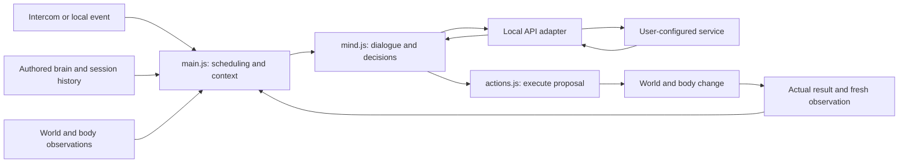

# Add features and interactions

Start with a concrete behavior and follow it through the runtime. For an embodied feature, a model suggestion must become a validated action, an actual world change, and a recorded result. UI-only features may need no model changes; new sensor feeds need an accurate observation path.

## Runtime map



Recognized local commands in `commands.js` can go directly to execution, without waiting for a language-model decision. Ordinary dialogue can skip a new image. Inspection aims and captures a fresh frame before its report. The full graph is available locally; prompt construction selects bounded context rather than sending every stored memory each turn.

## Example: add a new usable object

Suppose you want an easel the character can inspect and adjust.

1. **Build and register it.** Add geometry in `world.js`. Decide whether it is a fixed feature or a movable item. Register a fixed target in `FEATURES`, or use the existing item registration pattern for a loose object. Add its collision footprint and safe approach point where needed. An object ID should remain stable across its rendering, actions and save data.
2. **Implement its state.** Decide what adjustment means: angle, height, on/off state, or another measurable change. Define limits and defaults. Implement the actual transformation and decide how reload restores it. The existing save serializer does not automatically preserve every custom field or fixed-feature state.
3. **Implement the action.** Extend the dispatcher or the appropriate `USE` handler in `actions.js`. Resolve the target, navigate if needed, perform the operation, and return the observed outcome. Report unknown targets, blocked routes and failures honestly. Use the existing action timing/cancellation pattern so interruption cannot leave background work or stale callbacks running.
4. **Expose it to the agent.** Update the action vocabulary in `mind.js` and relevant current-state descriptions in `main.js`. Keep the existing decision envelope. Add aliases if needed. Only add a parser rule in `commands.js` when an unambiguous operator imperative should execute locally; questions should remain conversation.
5. **Expose it to the user.** Add a control only if the user needs direct access. Keep its label, handler and keyboard behavior aligned. If it generates a new event, journal the real event once rather than on every animation frame.
6. **Inspect and verify.** Confirm `inspect easel` aims at the actual object and acquires its current appearance when vision is connected. Test adjustment, invalid values, blocked approaches, cancellation and persistence. A static description is useful object metadata, but does not replace a fresh optical reading.

For a completely new action, update the prompt catalog and the dispatcher together. `parseDecision()` parsing an action object does not establish that a real handler exists; the dispatcher has a fallback for unfamiliar actions, which is not an implementation of the requested capability. Keep action lists bounded and preserve the difference between intention and completion.

## Add sensors and events

Follow the existing nervous system, cognitive state and climate modules for local state updates. Keep simulation frequency separate from inference frequency. Sensations and animation may update each frame, while `thought-clock.js` and the host schedule model requests.

For a new feed, define its units, observation time, source, availability and failure behavior. Add a concise current reading to `senses()` through the existing prioritized context builder. Decide whether meaningful changes create an event and how repeated changes are coalesced. Never turn an unavailable sensor into a confident reading or treat model interpretation as a physical measurement.

If a scenario's new events should enter long-term session memory, inspect the explicit event selection in `session-memory.js`. Not every journal row is retained there. If they should alter learned tendencies, add explicit outcome/channel handling in `experience-state.js` with evidence and bounds. Do not silently rewrite authored biography.

## Adapt autonomy and conversation

The shipped default graph contains `behavior`, enabling the experience-driven policy when AI is connected. The small starter graph omits it; legacy/random movement paths still exist. Offline local movement, operator action priority and special modes also influence behavior. Inspect the branches in `main.js`, `random-actions.js` and the mode modules before describing the character as fully autonomous or fully still.

Use `thought-clock.js` for request pacing, `prompt-context.js` for bounded context, and `speech-cadence.js` for when generated lines become speech. Changing pulse speed should not multiply API calls. New intercom messages, visual actions, cancellation and queued replies must still work when a request is in progress. Keep new features within the configured service's capacity.

## Generated content and new APIs

The existing supported generation paths are chalk strokes, sandboxed computer apps, and validated procedural 3D creations. They do not grant generated code access to the host, local credentials, arbitrary network access or the repository.

- Computer apps use `sandbox.js` and a script-only iframe with restrictive CSP. Keep that boundary intact when adding app features.
- Procedural objects run through `creator.js`, `creation-worker.js` and `creation-model.js`. Read both the generation prompt and runtime validator; their limits serve different purposes. Validate meshes and transformations before adding them to the world.
- New service calls belong behind an explicit backend contract. Follow [API-INTEGRATION.md](API-INTEGRATION.md) for authentication, request validation, model aliases and secret handling. Connecting a model does not automatically connect its unrelated tools, accounts or integrations.

If a new feature needs network access, persistent backend storage or an external tool, describe its inputs, permissions, outputs, timeout, cancellation and error contract first. Keep credentials server-side and use mocked endpoints during development. Consult the selected service's official documentation when implementing its actual integration.

## Ask your coding agent to add a feature

```text
Read AGENTS.md and docs/EXTENDING.md. Implement this feature in my
local checkout: [what the user or embodied agent can do].

Trigger: [UI control / intercom command / supported model action / event].
Expected world or UI change: [specific visible behavior].
Success result: [what can truthfully be reported].
Failure cases: [unknown target, blocked path, unavailable service, ...].
Persistence: [what should survive a reload and what should reset].

Follow the existing architecture. Implement the real behavior, wire the
relevant action vocabulary, target resolution, sensor context and UI,
and preserve cancellation and request pacing. Keep authored memory
separate from observed outcomes. Use bounded data and server-only
credentials for any new integration. Add meaningful regression checks,
exercise the flow in the browser, and update its documentation.
Use mocks for service development. Report what works and remaining
limits; do not deploy or make paid calls unless I ask.
```

## Validate and document the result

Run `npm test`, `npm run brain:validate`, `npm run build`, `npm audit` and `npm run privacy:check` as relevant to the change. New mechanics need tests for actual behavior and important failure paths. Browser checks cover rendered geometry, interaction, observation order and UI feedback that pure tests cannot establish. Keep live service tests separate and report whether they were actually performed.

Update the action catalog, user instructions and any scenario guide affected by the change. Explain any new backend requirements or stored data. A working feature should be discoverable and should state its real limitations.
